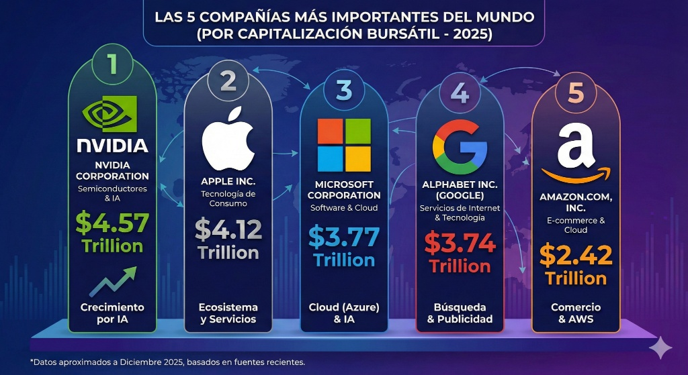

# Sistema solar 3D de empresas

**Categoría:** [Apps 3D e interactivas](README.md) · **Tecnologías:** Three.js r182

Sistema solar en 3D donde cada planeta es una de las empresas más valiosas, con vista alternativa de gráfico de torta.

Adjunta esta imagen de referencia junto con el prompt:



## Prompt

```text
Hice una prueba de GPT 5.2 Thinking vs Gemini 3.0 Pro y este es el resultado.

Prompt
Recrear el Sistema solar con todos sus planetas en 3D pero cada planeta debe ser una empresa de las que están en la imagen con los efectos generados de three.js en su nueva versión.
https://github.com/mrdoob/three.js/releases/tag/r182?s=08
también debe existir una opción para cambiar de la forma de sistema solar a la forma de grafico de tortas.
Cuando coloque el puntero del mouse en un planeta, que de los datos básicos de la empresa.
Los planetas deben ser lo más realistas posibles.
Los planetas giran alrededor de su mismo eje y también alrededor del sol.
Las líneas deben cruzar los planetas, cada línea debe ser de un color diferente.
Que se puede graduar la velocidad.
La página debe ser responsive.
Debe tener sonido y se debe poder activar y desactivar el volumen.
Se pueda ocultar o mostrar los menús.
```
